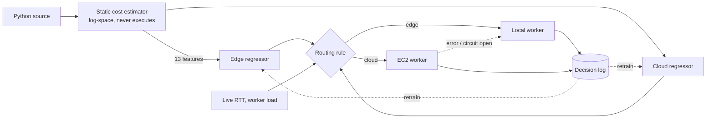

# AI Scheduler: edge-or-cloud routing for Python jobs

Given a Python script, predict how long it would take on your local machine
(the *edge*) and on an AWS EC2 worker (the *cloud*), add the network round trip,
and run it on whichever is expected to finish first. The script is analysed
statically; it is never executed to make the decision.

```
offload to cloud  iff  predicted_cloud_compute + RTT + transfer + queue  <  predicted_edge_compute + queue
```

## Status: what the measurements say

Everything below is reproduced by `bench/run_benchmarks.py` (full table in
[`bench/RESULTS.md`](bench/RESULTS.md)).

* On the project's own 495 measured scripts, the cloud (compute + 110 ms RTT) beat the edge on
  **1**. The two machines are about equally fast, so there is almost nothing to offload.
  Real gains need a real hardware difference between the nodes: [docs/DEPLOY.md](docs/DEPLOY.md).
* Total wall-clock time over those scripts, whole script families held out:
  always-edge 106 s, **scheduler 109 s (+3.1%)**,
  always-cloud 183 s (+73%), oracle 106 s.
* **With a real compute asymmetry** (Docker: edge worker `--cpus=0.5`, cloud worker `--cpus=4`, same machine, simulated
  110 ms delay; 591 scripts, [`data/docker_asym_v1`](data/docker_asym_v1), report in
  [`bench/ASYM_RESULTS.md`](bench/ASYM_RESULTS.md)): the cloud wins on 61 scripts and the **scheduler is 6.9% faster than
  always-edge** (254.8 s vs 273.7 s; oracle 237.8 s; 95% bootstrap interval -10.8% to -3.8%, resampling scripts). One run,
  simulated network: not an EC2 measurement. Models: `models/asym/` (`SCHEDULER_MODELS_DIR=models/asym`).
  With 42 added heavy workloads (dense linear algebra, FFT, large NumPy; [`data/docker_asym_v2`](data/docker_asym_v2),
  633 scripts) the scheduler is **23.9% faster than always-edge** and 0.6% from the oracle (95% interval -31.4% to -17.2%),
  but that depends on a mix we wrote to favour the cloud. Models: `models/asym_v2/`. See
  [`bench/ASYM_RESULTS_v2.md`](bench/ASYM_RESULTS_v2.md).
* The first version of this project (classifier trained on a synthetic "edge slowdown" label) would have made the same
  workload +36% slower than always-edge; it reported "99.4% accuracy" because it
  re-learned its own label formula. The classifier is gone and nothing is trained on synthetic labels.
* Latency models (held-out families): R² 0.91 edge / 0.89 cloud on log10 seconds.
  Median error 3% (cloud) and 15% (edge).
* Speed: feature extraction 0.63 ms, a full scheduling decision
  3.6 ms (p50).

## How it works



* **Feature extractor** (`pipeline/feature_extractor.py`): estimates work in log10 "equivalent Python ops" from each loop's
  own `range()` bound, comprehensions, user-function call sites, recursion (`fib(35)` vs `fib(20)`), NumPy array sizes
  (matmul/linalg as flops, sort/FFT as n log n), and time-bounded busy-waits. Unknown bounds fall back to documented
  defaults. It cannot follow data-dependent control flow, classes beyond simple methods, or I/O.
* **Predictor** (`pipeline/predictor.py`): two `HistGradientBoostingRegressor`s on log10 seconds, trained on measured times only
  (`train_model.py`). Confidence is the probability that the chosen side is really faster, from the out-of-fold error.
* **Dispatcher** (`pipeline/dispatcher.py`): authenticated calls, cloud errors fall back to the edge, a circuit breaker,
  live RTT from `/health` pings, queue-aware routing, a JSONL decision log, optional epsilon-greedy exploration.
  The Streamlit UI runs every workload through it.
* **Runtime history** (`pipeline/history.py`): once a script (by content hash) has two clean runs on a side, its observed
  median replaces the regression there. This covers code the static analyser cannot see through.
* **Worker** (`worker/`): `runner.py` runs jobs with rlimits, a scrubbed environment and a process-group timeout;
  `worker_server.py` is a thin FastAPI wrapper with an API key and `/health`. See the security note below.

## Setup

```bash
git clone https://github.com/Adithya-109/ai-scheduler-aws.git && cd ai-scheduler-aws
python3 -m venv .venv && source .venv/bin/activate
pip install -r requirements.txt
cp .env.example .env            # fill in WORKER_API_KEY (+ CLOUD_WORKER_URL for the cloud node)
```

Versions are pinned because the model pickles are scikit-learn-version specific.

```bash
python worker/worker_server.py          # edge worker on 127.0.0.1:8000  (or: docker compose up --build)
streamlit run app.py                    # dashboard on http://localhost:8501
```

The cloud node: [docs/DEPLOY.md](docs/DEPLOY.md). With `CLOUD_WORKER_URL` unset everything runs edge-only.

## Security

The worker **executes arbitrary Python**. It requires `X-API-Key`, refuses to listen on a non-loopback address without a key,
limits memory/CPU/output/size, and doesn't pass its environment to jobs. That is hardening, not a sandbox. Run it in a
container or VM with no credentials and no outbound network, restrict the security group to your IP, and prefer a tunnel
or TLS. Details in [docs/DEPLOY.md](docs/DEPLOY.md).

## Develop

```bash
python3 -m unittest discover -s tests -t . -v
ruff check .
python3 bench/run_benchmarks.py                   # writes bench/results.json + RESULTS.md
python3 train_model.py                            # retrain from hardware_benchmark.csv
python3 bench/holdout.py                          # unseen-workload run (16 hand-written scripts in holdout/)
./scripts/build_docx.sh                           # rebuild the .docx from RESEARCH_PAPER.md (pandoc)
python3 collect_data.py --repeats 5               # re-measure on real hardware (needs CLOUD_WORKER_URL)
```

* `tests/test_audit.py`: assertions about what the project claims; `test_extractor.py`: properties of the cost model;
  `test_models.py`: artifact integrity, the routing rule, quality gates; `test_system.py`: worker, dispatcher, collection
  over real sockets; `test_app_smoke.py`: runs `app.py` and the real execution path against a fake Streamlit;
  `test_history.py`, `test_holdout.py`, `test_terraform.py`: runtime history, the unseen-workload floor, Terraform guards.
* UI code lives in `ui/` (theme, header, execution, `pages/`); `app.py` only wires state, theme and page dispatch.
* `deploy/terraform/` builds a locked-down EC2 worker (see docs/DEPLOY.md). It has not been run through `terraform validate`.
* `hardware_benchmark.csv` is keyed by script filename and features are recomputed from `test_scripts/` on every
  training run, so changing the extractor never leaves stale columns.
  The 495 rows came from migrating the legacy 591-row file (`scripts/migrate_dataset.py`); 96 rows that could not be
  attributed to a single script were dropped. Re-collect on real hardware to replace them.

## Known limits

* The migrated timings come from two similar machines; see Status. The scheduler cannot be shown to help until that changes.
* `RESEARCH_PAPER.md` / the `.docx` now report the measured results. The literature survey and references are carried over
  from the first draft and were not re-verified; check them before submission.
* The static estimate generalises only moderately: Spearman 0.39 against measured runtime on 16 unseen scripts
  (`bench/holdout.py`). Loop bounds from `len()` and non-constant `while` bounds are the main misses.
* The Streamlit UI has only been exercised through the fake-Streamlit smoke test, not a live browser session.
* The worker HTTP layer (FastAPI) is covered by an equivalent stdlib server in the tests, not by FastAPI itself.

## Academic context

Developed for the Cloud Computing (CAD) course at Vellore Institute of Technology (VIT).
