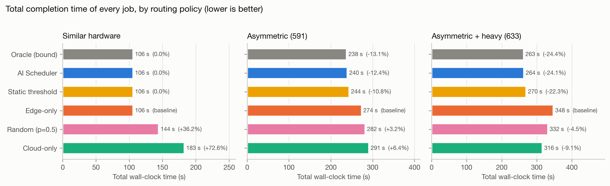
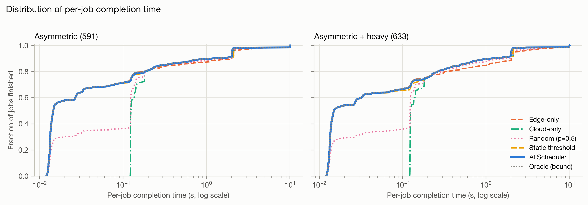
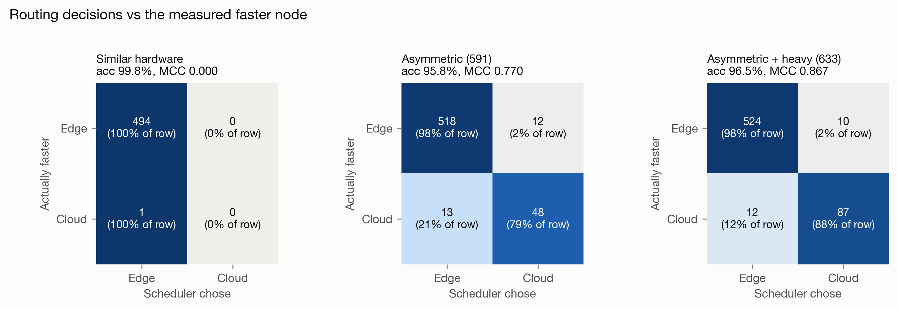
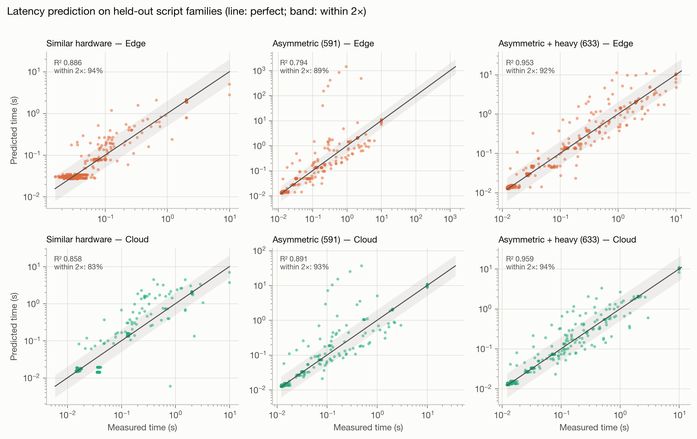
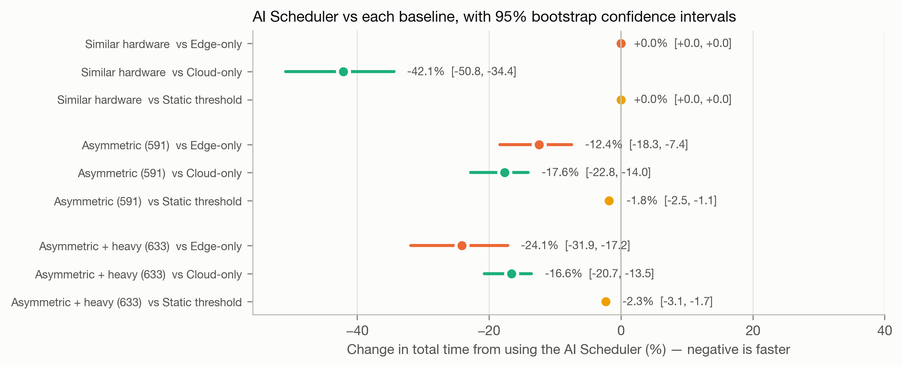
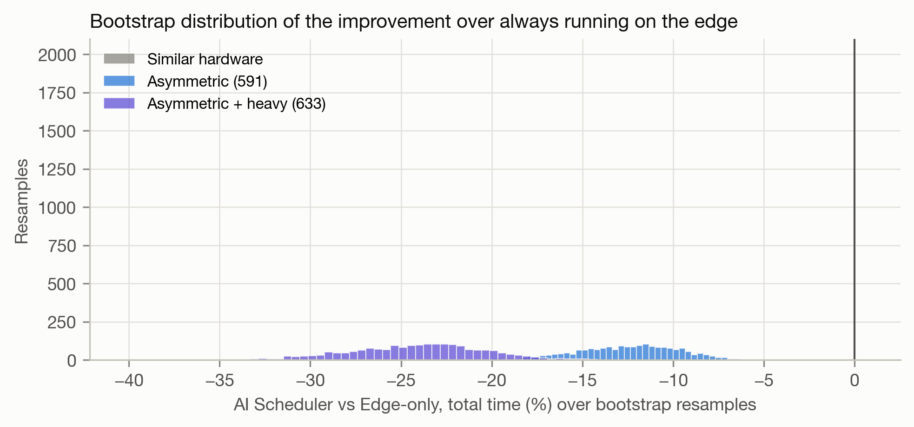
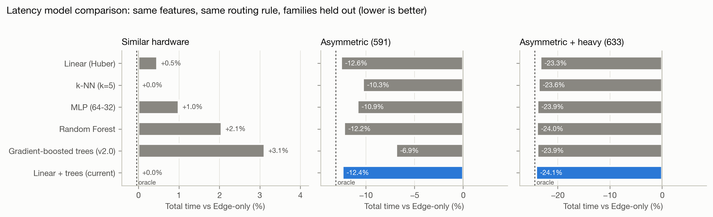
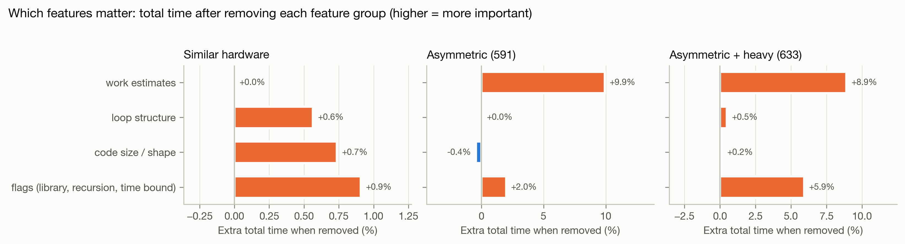
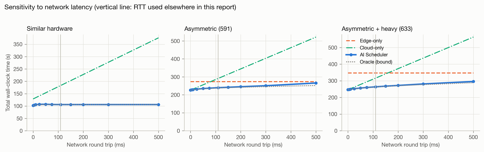
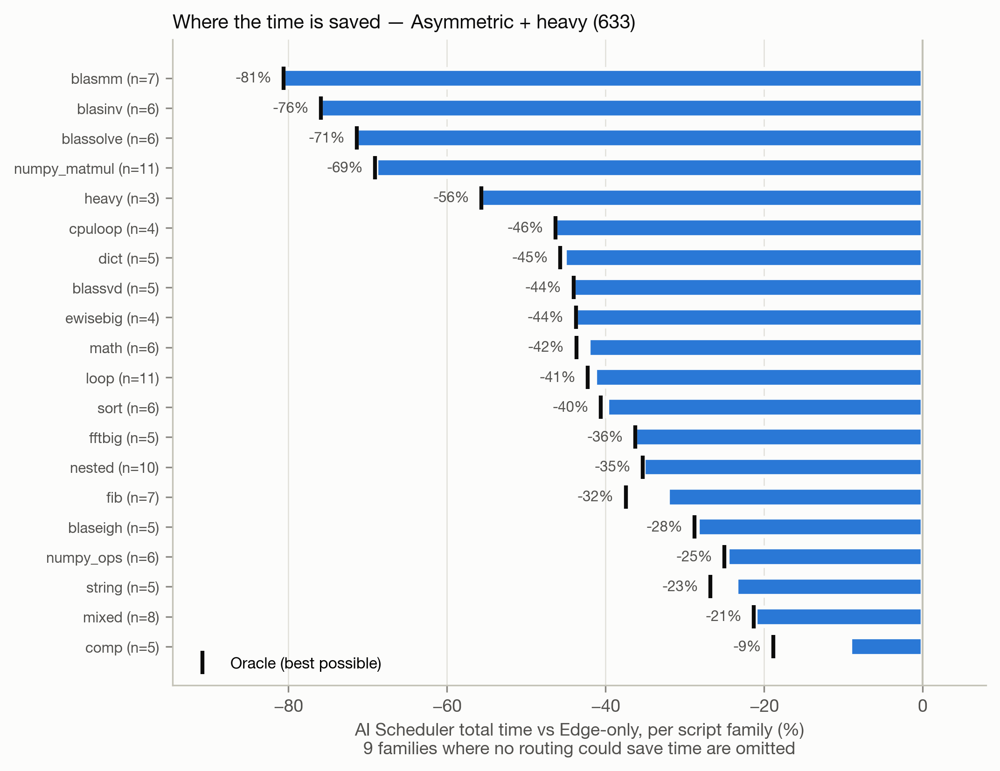

# Benchmark evaluation: AI Scheduler vs cloud-only, edge-only and other baselines

Generated by `bench/paper_eval.py` on 2026-10-29 00:55 (python 3.13.1, scikit-learn 1.9.1, 2000 bootstrap resamples). All policies are scored on **measured** edge and cloud run times. The AI Scheduler and the static-threshold baseline only use predictions made with the script's whole family held out of training (grouped K-fold), so these are out-of-sample numbers.

## Headline

* **With a real hardware gap** (edge 0.5 CPU vs cloud 4 CPU, 110 ms RTT): the AI Scheduler finishes all 633 jobs in **264 s**, 24.1% faster than edge-only (95% CI [-31.9, -17.2]%) and 16.6% faster than cloud-only; it is 0.3% from the oracle (99.7% oracle efficiency).
* Without the heavy workloads (591 jobs): -12.4% vs edge-only (CI [-18.3, -7.4]%), -17.6% vs cloud-only.
* **Routing accuracy** (chose the node that was really faster): 96.5% / 95.8% / 99.8% on the three datasets; MCC 0.867 / 0.770 / 0.000. On jobs where the choice matters by ≥10% the accuracy is 98.4% / 97.9% / 100.0%.
* **Latency-prediction accuracy** (log10 R², families held out): edge 0.953, cloud 0.959 (asymmetric + heavy); median absolute error 5% edge, 3% cloud.
* **Similar hardware** (the original edge vs EC2 data): the cloud is faster on only 1/495 jobs once RTT is paid, so there is nothing to gain; the scheduler is +0.0% vs edge-only and -42.1% vs cloud-only.
* **A tuned one-feature heuristic is a strong baseline.** Offloading whenever the static cost estimate exceeds a threshold (tuned on training folds) is -10.8% / -22.3% vs edge-only on the 591 / 633-job sets; the AI Scheduler is -12.4% / -24.1%, with far fewer wrong offloads (cloud precision 80% / 90% vs 43% / 56%). The previous gradient-boosted-trees model lost to this heuristic on the 591 set (-6.9%): trees cannot extrapolate, so a held-out matrix-multiply family was predicted at ~0.07 s instead of up to 4 s and never offloaded. The current model adds a linear term on the work estimates (Table 6).
* **Overhead**: one scheduling decision takes 7.3 ms (p50), 8.6 ms (p95).

## Table 1 — Policy comparison (total and per-job completion time)

Random is the expectation over 1000 coin-flip assignments. *Regret vs oracle* is how much slower than an all-knowing router. *Decision acc.* is the share of jobs sent to the node that was really faster.

| Dataset | Policy | Total (s) | Mean (s) | p95 (s) | vs Edge-only | vs Cloud-only | Regret vs oracle | Routed to cloud | Decision acc. |
| --- | --- | ---: | ---: | ---: | ---: | ---: | ---: | ---: | ---: |
| Similar hardware | Edge-only | 106.0 | 0.214 | 2.026 | +0.0% | -42.1% | +0.0% | 0 | 99.8% |
| Similar hardware | Cloud-only | 182.9 | 0.370 | 2.125 | +72.6% | +0.0% | +72.7% | 495 | 0.2% |
| Similar hardware | Random (p=0.5) | 144.4 | 0.292 | 2.037 | +36.2% | -21.1% | +36.3% | 248 | 50.0% |
| Similar hardware | Static threshold | 106.0 | 0.214 | 2.026 | +0.0% | -42.1% | +0.0% | 0 | 99.8% |
| Similar hardware | **AI Scheduler** | 106.0 | 0.214 | 2.026 | +0.0% | -42.1% | +0.0% | 0 | 99.8% |
| Similar hardware | Oracle (bound) | 105.9 | 0.214 | 2.026 | -0.0% | -42.1% | +0.0% | 1 | 100.0% |
| Asymmetric (591) | Edge-only | 273.7 | 0.463 | 2.076 | +0.0% | -6.0% | +15.1% | 0 | 89.7% |
| Asymmetric (591) | Cloud-only | 291.1 | 0.492 | 2.126 | +6.4% | +0.0% | +22.4% | 591 | 10.3% |
| Asymmetric (591) | Random (p=0.5) | 282.3 | 0.478 | 2.125 | +3.2% | -3.0% | +18.7% | 295 | 50.1% |
| Asymmetric (591) | Static threshold | 244.1 | 0.413 | 2.126 | -10.8% | -16.1% | +2.6% | 113 | 87.1% |
| Asymmetric (591) | **AI Scheduler** | 239.7 | 0.406 | 2.017 | -12.4% | -17.6% | +0.8% | 60 | 95.8% |
| Asymmetric (591) | Oracle (bound) | 237.8 | 0.402 | 2.017 | -13.1% | -18.3% | +0.0% | 61 | 100.0% |
| Asymmetric + heavy (633) | Edge-only | 347.5 | 0.549 | 2.217 | +0.0% | +10.0% | +32.2% | 0 | 84.4% |
| Asymmetric + heavy (633) | Cloud-only | 316.0 | 0.499 | 2.126 | -9.1% | +0.0% | +20.3% | 633 | 15.6% |
| Asymmetric + heavy (633) | Random (p=0.5) | 331.8 | 0.524 | 2.127 | -4.5% | +5.0% | +26.3% | 317 | 50.0% |
| Asymmetric + heavy (633) | Static threshold | 269.9 | 0.426 | 2.126 | -22.3% | -14.6% | +2.7% | 162 | 87.2% |
| Asymmetric + heavy (633) | **AI Scheduler** | 263.7 | 0.417 | 2.017 | -24.1% | -16.6% | +0.3% | 97 | 96.5% |
| Asymmetric + heavy (633) | Oracle (bound) | 262.8 | 0.415 | 2.017 | -24.4% | -16.8% | +0.0% | 99 | 100.0% |

## Table 2 — Routing accuracy (is the cloud faster for this job?)

Positive class = *cloud is faster including RTT*. The class balance differs a lot between datasets, so compare accuracy with the majority-class baseline and read balanced accuracy and MCC. *Decisive* keeps only jobs where the two nodes differ by at least 10%; on the rest either choice costs under 10%.

| Dataset | Subset | n | Accuracy (95% CI) | Majority baseline | Balanced acc. | Precision | Recall | F1 | MCC | TP/FP/FN/TN |
| --- | --- | ---: | ---: | ---: | ---: | ---: | ---: | ---: | ---: | --- |
| Similar hardware | AI Scheduler, all | 495 | 99.8% (98.9–100.0) | 99.8% | 50.0% | 0.0% | 0.0% | 0.000 | 0.000 | 0/0/1/494 |
| Similar hardware | AI Scheduler, decisive | 465 | 100.0% (99.2–100.0) | 100.0% | n/a | 0.0% | 0.0% | 0.000 | n/a | 0/0/0/465 |
| Similar hardware | Static threshold, all | 495 | 99.8% (98.9–100.0) | 99.8% | 50.0% | 0.0% | 0.0% | 0.000 | 0.000 | 0/0/1/494 |
| Asymmetric (591) | AI Scheduler, all | 591 | 95.8% (93.8–97.1) | 89.7% | 88.2% | 80.0% | 78.7% | 0.793 | 0.770 | 48/12/13/518 |
| Asymmetric (591) | AI Scheduler, decisive | 521 | 97.9% (96.3–98.8) | 90.2% | 94.5% | 88.5% | 90.2% | 0.893 | 0.882 | 46/6/5/464 |
| Asymmetric (591) | Static threshold, all | 591 | 87.1% (84.2–89.6) | 89.7% | 84.1% | 43.4% | 80.3% | 0.563 | 0.528 | 49/64/12/466 |
| Asymmetric + heavy (633) | AI Scheduler, all | 633 | 96.5% (94.8–97.7) | 84.4% | 93.0% | 89.7% | 87.9% | 0.888 | 0.867 | 87/10/12/524 |
| Asymmetric + heavy (633) | AI Scheduler, decisive | 559 | 98.4% (97.0–99.2) | 84.1% | 97.2% | 94.4% | 95.5% | 0.950 | 0.940 | 85/5/4/465 |
| Asymmetric + heavy (633) | Static threshold, all | 633 | 87.2% (84.4–89.6) | 84.4% | 88.7% | 55.6% | 90.9% | 0.690 | 0.644 | 90/72/9/462 |

## Table 3 — Latency-prediction accuracy (regression)

APE = absolute percentage error. *Within 2×* = prediction within a factor of two of the measured time.

| Dataset | Node | R² (log10) | MAE (log10) | Median APE | Within ±25% | Within 2× | Spearman ρ |
| --- | --- | ---: | ---: | ---: | ---: | ---: | ---: |
| Similar hardware | edge | 0.886 | 0.107 | 15.1% | 71.1% | 93.5% | 0.645 |
| Similar hardware | cloud | 0.858 | 0.126 | 2.8% | 72.3% | 83.0% | 0.737 |
| Asymmetric (591) | edge | 0.794 | 0.118 | 4.6% | 78.8% | 89.3% | 0.904 |
| Asymmetric (591) | cloud | 0.891 | 0.079 | 2.6% | 85.8% | 92.6% | 0.885 |
| Asymmetric + heavy (633) | edge | 0.953 | 0.085 | 5.0% | 79.3% | 91.8% | 0.918 |
| Asymmetric + heavy (633) | cloud | 0.959 | 0.062 | 2.9% | 87.0% | 94.0% | 0.907 |

## Table 4 — Statistical significance

Δ total is the change in total time from using the AI Scheduler instead of the baseline (negative = faster), with 95% bootstrap intervals resampling scripts and, more conservatively, whole families. The Wilcoxon signed-rank test is on paired per-job times (jobs where both policies made the same choice are tied and dropped). Rank-biserial r < 0 means the scheduler is faster.

| Dataset | Comparison | Δ total (95% CI, scripts) | 95% CI, families | Wilcoxon p | Rank-biserial r | Jobs faster / slower |
| --- | --- | ---: | ---: | ---: | ---: | ---: |
| Similar hardware | AI Scheduler vs Edge-only | +0.0% [+0.0, +0.0] | [+0.0, +0.0] | n/a | n/a | 0 / 0 |
| Similar hardware | AI Scheduler vs Cloud-only | -42.1% [-50.8, -34.4] | [-61.4, -29.0] | < 1e-10 | -1.000 | 494 / 1 |
| Similar hardware | AI Scheduler vs Static threshold | +0.0% [+0.0, +0.0] | [+0.0, +0.0] | n/a | n/a | 0 / 0 |
| Asymmetric (591) | AI Scheduler vs Edge-only | -12.4% [-18.3, -7.4] | [-29.9, -4.7] | 7.1e-08 | -0.800 | 48 / 12 |
| Asymmetric (591) | AI Scheduler vs Cloud-only | -17.6% [-22.8, -14.0] | [-29.4, -11.2] | < 1e-10 | -0.969 | 518 / 13 |
| Asymmetric (591) | AI Scheduler vs Static threshold | -1.8% [-2.5, -1.1] | [-2.5, -0.1] | 5.2e-08 | -0.743 | 61 / 10 |
| Asymmetric + heavy (633) | AI Scheduler vs Edge-only | -24.1% [-31.9, -17.2] | [-45.5, -11.2] | < 1e-10 | -0.947 | 87 / 10 |
| Asymmetric + heavy (633) | AI Scheduler vs Cloud-only | -16.6% [-20.7, -13.5] | [-26.9, -10.7] | < 1e-10 | -0.984 | 524 / 12 |
| Asymmetric + heavy (633) | AI Scheduler vs Static threshold | -2.3% [-3.1, -1.7] | [-3.3, -1.4] | < 1e-10 | -0.865 | 70 / 11 |

## Table 5 — Datasets and robustness to the validation split

Leave-one-family-out trains on every family but one and tests on the one left out, for every family.

| Dataset | Scripts | Families | RTT | Median edge / cloud (s) | Cloud wins | 5-fold vs edge | Leave-one-family-out vs edge | LOFO accuracy |
| --- | ---: | ---: | ---: | ---: | ---: | ---: | ---: | ---: |
| Similar hardware | 495 | 20 | 110 ms | 0.035 / 0.017 | 1 | +0.0% | +0.0% | 99.8% |
| Asymmetric (591) | 591 | 21 | 110 ms | 0.015 / 0.015 | 61 | -12.4% | -8.6% | 94.4% |
| Asymmetric + heavy (633) | 633 | 29 | 110 ms | 0.015 / 0.015 | 99 | -24.1% | -23.7% | 95.1% |

## Table 6 — Latency model comparison

Every model sees the same 13 static features, predicts log10 seconds on each node, and feeds the same routing rule; folds hold out whole script families. Cells: total time vs Edge-only / routing accuracy / R² (edge, cloud). *Gradient-boosted trees (v2.0)* is the previous production model; *Linear + trees* adds a robust linear term on the work estimates so predictions extrapolate to families with more work than any seen in training.

| Model | Similar hardware: vs edge / acc / R² edge, cloud | Asymmetric (591): vs edge / acc / R² edge, cloud | Asymmetric + heavy (633): vs edge / acc / R² edge, cloud |
| --- | ---: | ---: | ---: |
| Linear (Huber) | +0.5% / 98.8% / 0.74, 0.79 | -12.6% / 95.6% / 0.86, 0.91 | -23.3% / 94.5% / 0.91, 0.93 |
| k-NN (k=5) | +0.0% / 99.8% / 0.86, 0.83 | -10.3% / 93.7% / 0.90, 0.91 | -23.6% / 94.8% / 0.93, 0.94 |
| MLP (64-32) | +1.0% / 97.8% / 0.82, 0.78 | -10.9% / 94.2% / 0.90, 0.92 | -23.9% / 94.9% / 0.93, 0.93 |
| Random Forest | +2.1% / 95.4% / 0.90, 0.88 | -12.2% / 95.8% / 0.96, 0.97 | -24.0% / 95.9% / 0.97, 0.97 |
| Gradient-boosted trees (v2.0) | +3.1% / 99.4% / 0.91, 0.89 | -6.9% / 93.2% / 0.92, 0.94 | -23.9% / 96.2% / 0.97, 0.97 |
| **Linear + trees (current)** | +0.0% / 99.8% / 0.89, 0.86 | -12.4% / 95.8% / 0.79, 0.89 | -24.1% / 96.5% / 0.95, 0.96 |

## Table 7 — Feature-group ablation (current model)

Each row zeroes one group of features and retrains. Larger loss = more important group.

| Features | Similar hardware: vs edge / acc | Asymmetric (591): vs edge / acc | Asymmetric + heavy (633): vs edge / acc |
| --- | ---: | ---: | ---: |
| all features | +0.0% / 99.8% | -12.4% / 95.8% | -24.1% / 96.5% |
| without work estimates | +0.0% / 99.8% | -3.7% / 90.2% | -17.4% / 90.2% |
| without loop structure | +0.6% / 98.6% | -12.4% / 95.9% | -23.7% / 96.2% |
| without code size / shape | +0.7% / 98.2% | -12.8% / 96.3% | -24.0% / 96.4% |
| without flags (library, recursion, time bound) | +0.9% / 97.8% | -10.7% / 95.3% | -19.6% / 94.3% |

## Network-latency sensitivity

Predictions do not depend on RTT; only the routing rule does, so the sweep re-applies the rule to the same out-of-fold predictions. Cloud-only degrades linearly with RTT while the scheduler shifts work back to the edge. From 50 ms upward the scheduler beats both fixed policies on the asymmetric data; near 0 ms cloud-only is as good or slightly better, and on similar hardware edge-only is always best.

| Dataset | RTT (ms) | Edge-only (s) | Cloud-only (s) | AI Scheduler (s) | Oracle (s) | Accuracy | Sent to cloud |
| --- | ---: | ---: | ---: | ---: | ---: | ---: | ---: |
| Similar hardware | 0 | 106.0 | 128.6 | 102.0 | 100.9 | 94.1% | 75.2% |
| Similar hardware | 10 | 106.0 | 133.6 | 105.7 | 104.2 | 75.2% | 75.2% |
| Similar hardware | 50 | 106.0 | 153.4 | 107.2 | 105.9 | 96.4% | 3.0% |
| Similar hardware | 110 | 106.0 | 183.1 | 106.0 | 105.9 | 99.8% | 0.0% |
| Similar hardware | 200 | 106.0 | 227.6 | 106.0 | 106.0 | 100.0% | 0.0% |
| Similar hardware | 500 | 106.0 | 376.1 | 106.0 | 106.0 | 100.0% | 0.0% |
| Asymmetric (591) | 0 | 273.7 | 226.0 | 226.7 | 226.0 | 68.0% | 81.7% |
| Asymmetric (591) | 10 | 273.7 | 232.0 | 228.9 | 227.7 | 90.9% | 29.3% |
| Asymmetric (591) | 50 | 273.7 | 255.6 | 235.0 | 233.4 | 93.6% | 19.8% |
| Asymmetric (591) | 110 | 273.7 | 291.1 | 239.7 | 237.8 | 95.8% | 10.2% |
| Asymmetric (591) | 200 | 273.7 | 344.2 | 245.1 | 242.2 | 95.3% | 8.5% |
| Asymmetric (591) | 500 | 273.7 | 521.5 | 265.8 | 251.9 | 94.1% | 4.2% |
| Asymmetric + heavy (633) | 0 | 347.5 | 246.4 | 246.8 | 246.3 | 67.9% | 77.9% |
| Asymmetric + heavy (633) | 10 | 347.5 | 252.7 | 249.4 | 248.5 | 91.9% | 34.8% |
| Asymmetric + heavy (633) | 50 | 347.5 | 278.1 | 256.5 | 255.9 | 96.1% | 24.3% |
| Asymmetric + heavy (633) | 110 | 347.5 | 316.0 | 263.7 | 262.8 | 96.5% | 15.3% |
| Asymmetric + heavy (633) | 200 | 347.5 | 373.0 | 272.2 | 270.5 | 96.5% | 13.3% |
| Asymmetric + heavy (633) | 500 | 347.5 | 562.9 | 295.9 | 288.5 | 95.6% | 7.9% |

## Where the gain comes from

| Dataset | Misrouted jobs | Time lost to misrouting | As share of edge-only total |
| --- | ---: | ---: | ---: |
| Similar hardware | 1 / 495 | 0.04 s (median 0.043 s) | 0.04% |
| Asymmetric (591) | 25 / 591 | 1.88 s (median 0.063 s) | 0.69% |
| Asymmetric + heavy (633) | 22 / 633 | 0.88 s (median 0.013 s) | 0.25% |

## Unseen hand-written workloads

On 16 hand-written scripts that the dataset generator never produced (`holdout/`), the static cost estimate has Spearman ρ = 0.39 with measured run time (`bench/holdout.py`). This is the weakest link: the regressors are only as good as the static features on code unlike the training families.

## How to read these results (threats to validity)

* The asymmetric datasets come from two Docker workers on one laptop with different CPU quotas and a **simulated** 110 ms RTT. They test the decision logic on a real compute gap; they are not an EC2 measurement. Only the similar-hardware dataset used a real cloud instance.
* The 42 heavy workloads in `asym_v2` were written to exercise the cloud; asym_v1 is the less favourable, more representative mix. Report both.
* Accuracy alone is misleading on the similar-hardware data (one positive in 495): always answering *edge* already scores 99.8%. Use balanced accuracy, MCC and the time-based metrics there.
* Each job was timed 3× (median kept); run-to-run noise on sub-50 ms jobs is comparable to the edge/cloud gap, which is why the *decisive* subset is reported.
* Single collection run per dataset; the bootstrap intervals capture workload variation, not machine-to-machine variation.

## Files

* `tables/` — every table as Markdown, CSV, and (tables 1–3) LaTeX `tabular` for the paper.
* `figures/` — every figure as 300-dpi PNG and vector PDF.
* `results.json` — all numbers above, machine-readable.

Figures: fig10_feature_ablation.png, fig1_policy_total_time.png, fig2_improvement_ci.png, fig3_latency_cdf.png, fig4_confusion_matrices.png, fig5_predicted_vs_measured.png, fig6_rtt_sensitivity.png, fig7_per_family.png, fig8_bootstrap_distribution.png, fig9_model_comparison.png.
