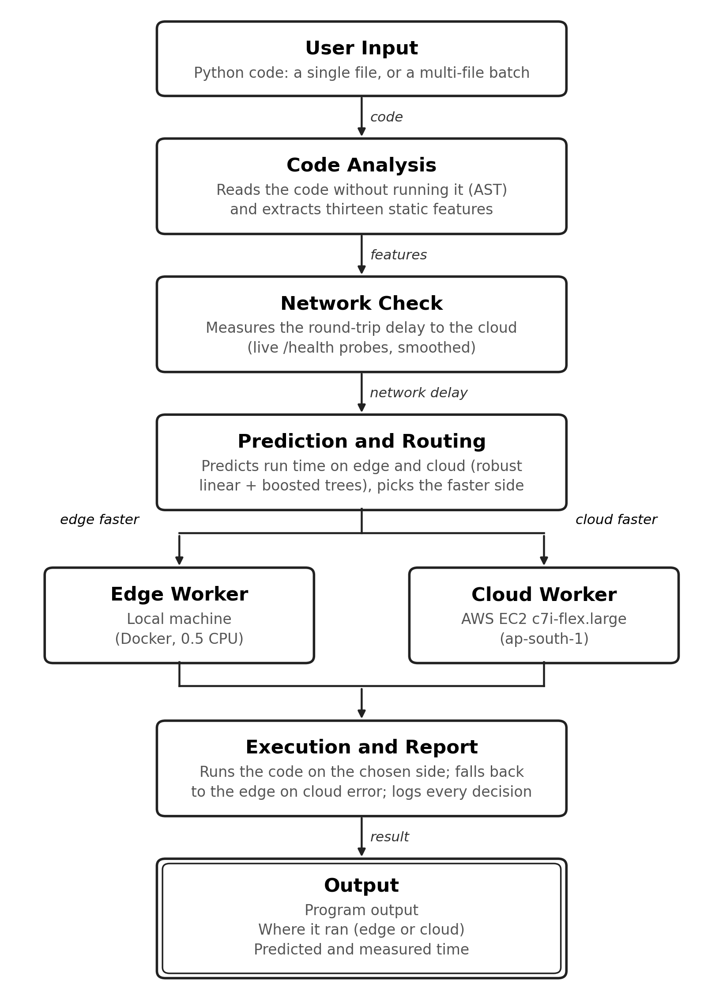
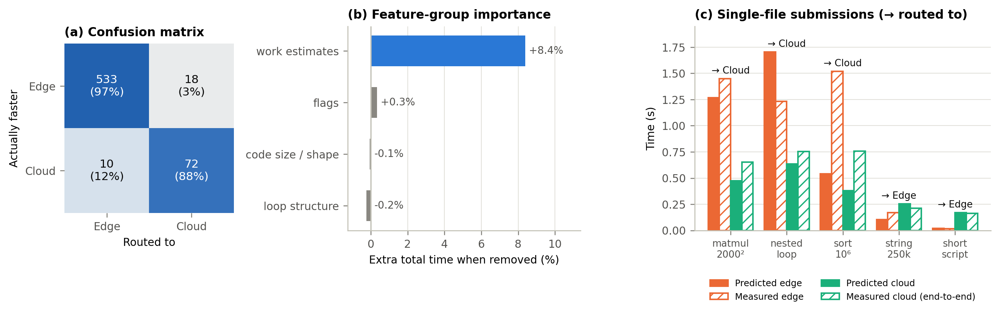
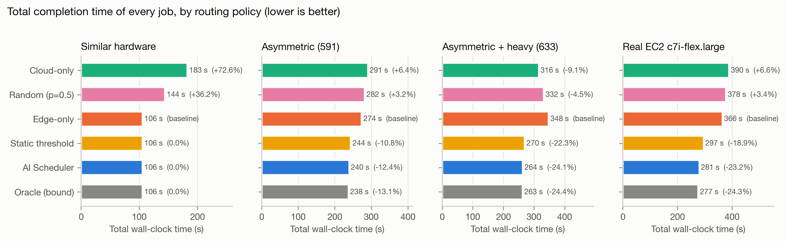
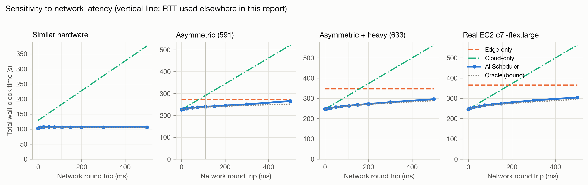

# AI Scheduler: Latency Optimal Edge - Cloud Workload Scheduling

Adithya Binoj Nair, Kushal Goyal, and Suriyanarayanan S

School of Computer Science and Engineering, Vellore Institute of Technology (VIT), Vellore, Tamil Nadu, India

## Abstract

Deciding where a user's program should run in an edge–cloud setup depends on how long it would take at each location. Running it locally can overload a weak edge device; sending it to the cloud adds network delay; and test-running the program first to find out costs time and means executing untrusted code. We present AI Scheduler, a four-module system that routes Python programs between an edge computer and an AWS EC2 cloud server. **Code Analysis** reads the program's abstract syntax tree without running it and extracts thirteen features, including log-scale estimates of interpreted operations, NumPy element operations and BLAS floating-point work, in 0.20 ms on average. **Network Check** measures the round-trip delay to the cloud with live probes. **Prediction and Routing** predicts the run time on each node with a robust linear model on the work estimates plus gradient-boosted trees on its residual, and sends the program to whichever node is expected to finish first. **Execution and Report** runs the program on the selected node, falls back to the edge if the cloud fails, and returns the output, the node used and the time taken; programs can be submitted one at a time or as a multi-file batch. We evaluated the system on 633 programs, each measured on both a CPU-limited edge and a c7i-flex.large EC2 instance over the real network (median round trip 155 ms), with whole program families held out of training. The scheduler routed 95.6 % of programs to the faster node (MCC 0.813), and completed the workload 23.2 % faster than always running at the edge (95 % CI 15.8–30.9 %) and 27.9 % faster than always offloading, within 1.5 % of an oracle that knows every run time in advance.

**Index Terms.** Computation offloading, edge–cloud orchestration, abstract syntax tree, latency prediction, gradient boosting, AWS EC2.

## 1. Introduction

Edge computing brings computation to where the data is generated, cutting latency and saving bandwidth [1]–[3]. Even so, tasks that need a lot of processing, such as matrix algebra, simulations and recursive searches, can push edge devices beyond their limits. A cloud instance offers more compute but adds wide-area-network (WAN) round-trip delay and jitter [4]–[6]. The best choice between edge and cloud therefore depends on how demanding the task is and on the current network conditions.

Existing schedulers face three problems. First, trial profiling takes time and requires running code that may not be trusted before deciding where to place it. Second, a scheduler that ignores real-time network changes can pick the wrong tier when the round-trip time shifts the point at which edge and cloud performance are equal [4], [5]. Third, latency models trained on a fixed set of workloads may not extrapolate: a program with more work than anything seen in training can be predicted to be cheap and kept on a slow edge.

We introduce AI Scheduler, a system that takes Python code and returns its result, the node where it ran and the time it took. It has four parts: Code Analysis, Network Check, Prediction and Routing, and Execution and Report. Our work makes four contributions. First, a zero-execution feature extractor that estimates a program's work in log space from its syntax tree. Second, live network-delay measurement that feeds the routing decision. Third, latency models that combine a robust linear term on the work estimates with gradient-boosted trees, so that predictions extrapolate to heavier workloads, used by a single, interpretable routing rule. Fourth, an evaluation on real AWS EC2 hardware with 633 workloads against fixed policies and existing methods, covering both single-file and multi-file batch submission.

## 2. Literature Survey

### 2.1 Edge Offloading and Learning-Based Scheduling

Zhou et al. [1], Wang et al. [2], and Deng et al. [3] survey edge intelligence and the convergence of edge computing with deep learning. Luo et al. [4] review edge resource scheduling, identifying latency, energy, and cost as its main objectives. Chen and Hao [5] formulate task offloading in ultra-dense networks as a latency-minimization problem, while Huang et al. [6] use deep reinforcement learning for online offloading. Mao et al. [7] learn cluster-scheduling policies with graph neural networks. Li et al. [8] and Hu et al. [9] divide DNN inference between a device and the edge according to available bandwidth. Wang et al. [10] adapt federated learning to edge resource constraints. Serverless studies [11]–[13] characterize cold starts and invocation patterns that affect cloud latency, and Gill et al. [14] discuss AI trends in next-generation computing. These studies optimize channel state, energy use, or known workload classes. The system presented here instead predicts the runtime of arbitrary user code.

### 2.2 Code Analysis and Performance Prediction

Allamanis et al. [15] survey machine learning for source code. Alon et al. [16], [17] learn representations from AST paths; Zhang et al. [18] encode statement subtrees; Zhou et al. [19] combine AST, control-flow, and data-flow graphs; and Ben-Nun et al. [20] learn code semantics from intermediate representations. Pre-trained code models [21]–[23] and large datasets [24], [25] extend this work to tasks such as code search and defect detection. For performance prediction, Wang and O'Boyle [29] survey machine learning in compilers. Mendis et al. [26] predict basic-block throughput, Chen et al. [27], [28] learn cost models for tensor programs, and Cummins et al. [30] and Brauckmann et al. [31] use graph-based program representations. Our input is a compact tabular feature set, for which tree ensembles remain competitive. Prokhorenkova et al. [32] address prediction shifts in boosting, while Grinsztajn et al. [33] and Shwartz-Ziv and Armon [34] show that tree-based models perform as well as or better than deep networks on medium-sized tabular data. These findings informed our choice of gradient boosting; Section 5.1 shows where trees alone fall short.

### 2.3 Research Gap and Novelty of This Work

Edge-offloading studies commonly assume that task descriptors are already available. Code-representation studies focus on semantic tasks, while performance predictors estimate hardware throughput without accounting for network delay or selecting a compute tier. To our knowledge, the surveyed work does not combine static code analysis, measured network delay, and extrapolating latency models in one operational edge–cloud pipeline evaluated on real cloud hardware. Table I summarizes the contributions of this project by module.

TABLE I. NOVELTY OF THE PROPOSED SYSTEM BY MODULE

| Module | Existing practice | Novelty introduced |
| --- | --- | --- |
| Code Analysis | Dynamic profiling or trial runs; code-learning models for semantic tasks | Zero-execution AST analysis of thirteen features, with log-space work estimates for Python, NumPy and BLAS operations |
| Network Check | Fixed or assumed network delay | Live probes of the cloud worker, smoothed and passed directly to every routing decision |
| Prediction and Routing | Two independent regressions compared directly, or a classifier on hand-made labels | Log-scaled regressors with a robust linear term that extrapolates, trained only on measured times; one routing rule with a stated confidence |
| Execution and Report | Task-specific or tier-specific interfaces | One authenticated REST interface for both tiers with edge fallback, single-file and multi-file batch submission, and a decision log for retraining |

## 3. Proposed System

### 3.1 Architecture and Decision Model

A user submits Python code, as a single file or a batch of files, and receives the output, execution node, and elapsed time (Fig. 1). Each program passes through four modules: Code Analysis examines the source, Network Check measures delay, Prediction and Routing estimates runtime on both tiers and selects a destination, and Execution and Report runs the code on the selected worker and returns the result. The edge worker is a local FastAPI service; the cloud worker is the same FastAPI service on an AWS EC2 instance in the ap-south-1 (Mumbai) region. The prediction models are trained offline on benchmark timings measured on both tiers.



Fig. 1. AI Scheduler architecture.

For edge execution, turnaround time equals compute time. Cloud execution also incurs the network round trip:

T_edge(S) = T_edge,compute(S),     T_cloud(S) = T_cloud,compute(S) + RTT_WAN      (1)

Offloading is beneficial only when the compute time saved exceeds the network delay:

D(S) = CLOUD  if  T̂_edge,compute(S) − T̂_cloud,compute(S) > RTT_WAN;  otherwise EDGE      (2)

where T̂ are predicted times. This is the only decision path; there is no secondary classifier that can veto it. When a worker's job slots are full, a queue penalty is added to its side of Eq. (2).

### 3.2 Code Analysis

Code Analysis parses the source with Python's `ast` module and walks the syntax tree without running the code. It returns thirteen features: number of lines, loops, maximum loop depth, operations, function calls and comprehensions; whether a numerical library is imported; whether a function is self-recursive; a time bound for busy-wait loops; and four work estimates, log10 of interpreted Python operations, NumPy element operations, BLAS floating-point operations, and their combination, estimated_complexity.

Work is computed in log space so that deeply nested or very large programs cannot overflow. A `for` loop over `range(n)` with a resolvable bound contributes log10(n), and nested loops add; an unresolvable bound defaults to 100 iterations (1000 for `while`). NumPy array sizes are read from constructor calls; matrix products, solves and decompositions contribute flops (n³ for an n×n product), sorts and FFTs n log n. For self-recursive functions the growth rate is found from the number of self-calls per body, so fib(35) is recognised as far more expensive than fib(20). The three channels are combined with documented cost ratios into estimated_complexity:

est = log10( 10^ops + 10^(elems − 1.5) + 10^(flops − 3) )      (3)

Because this module never runs the submitted code, it adds no load to the workers and does not expose them to that code. A node budget bounds the traversal, so pathological inputs are flagged rather than slowing the scheduler.

```
Algorithm 1: Static AST Feature Extraction
Input: source S
Output: feature vector X (13 features) or syntax error
 1  num_lines <- count of non-empty lines of S
 2  try T <- ParseAST(S)  catch SyntaxError -> return Error
 3  for each node v in Traverse(T), within a node budget:
 4    if v is For/While: num_loops++; depth++; trips <- log10(bound(v)) or default
 5                       work_scope += trips; visit body; depth--; work_scope -= trips
 6    elif v is BinOp/AugAssign: num_ops++; ops <- logsumexp(ops, work_scope)
 7    elif v is NumPy call: elems/flops <- logsumexp(.., work_scope + size(v))
 8    elif v is Call: num_calls++   elif v is Comprehension: num_comps++
 9    elif v is heavy-library Import: has_heavy_lib <- 1
10  detect self-recursion and busy-wait time bounds
11  est <- Eq. (3)
12  return [num_lines, num_loops, max_depth, num_ops, has_heavy_lib, num_calls,
           num_comps, has_recursion, time_bound, ops, elems, flops, est]
```

### 3.3 Network Check

Network Check measures the delay to the cloud by timing requests to the worker's lightweight /health endpoint. During operation, each probe updates an exponentially weighted moving average (α = 0.3), which smooths jitter while following real changes; the current value is passed directly to the routing decision so that placement reflects current network conditions. For data collection, 21 probes are taken and their median is recorded together with the 90th percentile. If no live estimate is available, the scheduler uses the value measured at training time.

```
Algorithm 2: Network Delay Estimation
Input: cloud health URL U, smoothing factor alpha
Output: tau_RTT (s)
 1  t0 <- now(); resp <- GET(U, timeout = 3 s)
 2  if resp.status = 200:
 3      sample <- now() - t0
 4      tau_RTT <- sample if tau_RTT undefined else alpha*sample + (1 - alpha)*tau_RTT
 5  if tau_RTT undefined: tau_RTT <- RTT measured at training time
 6  return tau_RTT
```

### 3.4 Prediction and Routing

Execution times span five orders of magnitude, so separate regressors are trained for the edge and the cloud on y = log10(T + ε), ε = 10⁻⁶, and times are recovered as T̂ = 10^ŷ − ε. Each regressor has two parts:

ŷ(X) = w·X_work + b  +  f_GBT(X)      (4)

where the first term is a robust (Huber) linear model on the four work estimates and f_GBT is a gradient-boosted tree ensemble (depth 5, learning rate 0.1, at most 100 trees, early stopping) fitted to the linear model's residual. The linear term grows with the estimated work, so a program heavier than anything in training is still predicted to be heavy; trees alone cannot extrapolate and predict the largest value they have seen (Section 5.1). Both models are trained only on measured times, never on synthetic labels.

The router applies Eq. (2). It also reports a confidence: with the out-of-fold residual spread of each model (σ_edge, σ_cloud, in log10 seconds), the log-ratio of the two predicted totals is treated as normally distributed, and the confidence is the probability that the chosen side is really faster. Once a program (identified by a hash of its source) has run at least twice on a side, the median of its observed times replaces the prediction for that side, which covers code the static analysis cannot see through.

```
Algorithm 3: Prediction and Routing
Input: X, tau_RTT, models M_edge, M_cloud, residual spreads s_edge, s_cloud
Output: decision D, confidence C, T_edge, T_cloud
 1  T_edge  <- 10^M_edge(X) - 1e-6      (or observed median, if known)
 2  T_cloud <- 10^M_cloud(X) - 1e-6 + tau_RTT
 3  d <- ln T_edge - ln T_cloud;  s <- ln10 * sqrt(s_edge^2 + s_cloud^2)
 4  if T_cloud < T_edge:  D <- CLOUD;  C <- Phi(d / s)
 5  else:                 D <- EDGE;   C <- 1 - Phi(d / s)
 6  return D, C, T_edge, T_cloud
```

### 3.5 Execution and Report

Execution and Report sends the code as JSON to the selected worker's /execute endpoint. The worker requires an API key, runs each job in a fresh, isolated Python process with a scrubbed environment, CPU-time, memory and output limits, and a wall-clock timeout, and returns standard output, standard error and compute time. If the cloud call fails, the job is re-run on the edge, and a circuit breaker stops sending work to a cloud node that keeps failing. Every dispatch is appended to a decision log (features, predictions, decision, outcome), from which the models can be retrained.

Both tiers use the same REST interface, so the scheduler selects a worker by changing the URL, and each worker can be replaced independently. The Streamlit dashboard presents four views: Overview; Live Dispatch for single-file and multi-file submission; Cluster and RTT for endpoint health checks and simulated-delay control; and Telemetry for model benchmarks and routing breakdowns.

**Single-file submission.** The user pastes or edits one program (presets are provided for matrix multiplication, string processing, recursive Fibonacci and nested loops) and runs it. The program passes once through the full pipeline, and the view reports the routing decision with its confidence, the predicted edge and cloud latencies, the predicted offload gain, the worker's compute time, the end-to-end time and the program's output.

**Multi-file batch submission.** The user uploads any number of .py files at once. Each file is treated as an independent job: it is analysed, routed and executed on its own, so files in one batch can run on different nodes, and a file that fails does not stop the others. Files run one after another, each with its own result panel, and all of them pass through the same dispatcher, so edge fallback, live RTT tracking and the decision log apply equally.

```
Algorithm 4: Execution and Report
Input: S, decision D, workers W_edge, W_cloud
Output: output, node, time taken
 1  W <- W_edge if D = EDGE else W_cloud;  t0 <- now()
 2  try resp <- POST(W.url + "/execute", {"code": S}, api_key, timeout = 65 s)
 3  catch error and D = CLOUD: record failure; resp <- POST(W_edge ...); node <- EDGE
 4  total <- now() - t0;  append (X, T_edge, T_cloud, D, resp) to decision log
 5  return {output: resp.stdout, errors: resp.stderr, node, compute: resp.exec_time,
           total, predicted: T_D}

Algorithm 5: Multi-file Batch Submission
Input: uploaded files F_1..F_n
Output: reports R_1..R_n
 1  for i = 1..n:
 2      S_i <- decode(F_i)
 3      X_i <- CodeAnalysis(S_i)            // on syntax error: report it, continue
 4      D_i <- Route(X_i, tau_RTT)           // Algorithm 3
 5      R_i <- ExecuteAndReport(S_i, D_i)    // Algorithm 4
 6  return R_1..R_n                          // batch time = sum of per-file times
```

## 4. Results and Implementation

### 4.1 Dataset and Setup

The evaluation uses 633 Python programs in 29 families (Table II). Each program was run three times on each tier and the median was kept. The edge was a Docker container limited to half a CPU core (`--cpus=0.5`, one BLAS thread) on an Apple-silicon laptop, standing in for a low-power edge device. The cloud was an AWS EC2 c7i-flex.large instance (2 vCPU, 4 GiB, Ubuntu 24.04) in ap-south-1, reached over the real network from the edge. For every cloud run we recorded both the worker's compute time and the client-side end-to-end time, and all cloud results are scored on the end-to-end time. Of the 633 programs, 551 were faster at the edge and 82 in the cloud. Models were evaluated with grouped 5-fold cross-validation in which whole program families are held out, so every prediction is for a kind of program the model has not seen; the software stack was Python 3.13, FastAPI, Streamlit and scikit-learn 1.9.

TABLE II. DATASET COMPOSITION (633 PROGRAMS, MEASURED ON REAL EC2)

| Workload category | Scripts | Cloud faster | Median edge time (s) | Representative benchmark |
| --- | ---: | ---: | ---: | --- |
| Generated mixed programs | 508 | 2 | 0.022 | Synthetic mixes of loops, calls, library use |
| Dense linear algebra | 40 | 33 | 0.897 | Matrix multiply, inverse, solve, SVD, eigen (200–4000²) |
| Nested compute loops | 33 | 16 | 0.269 | Double/triple loops, 10⁵–10⁸ iterations |
| Vectorised NumPy and FFT | 18 | 14 | 0.713 | Element-wise ops on 5–30 M floats, FFT 2¹⁸–2²³ |
| Math and comprehensions | 11 | 5 | 0.395 | math functions, list/dict comprehensions |
| Sorting and hashing | 11 | 9 | 1.051 | sort / dict build, 10⁵–2·10⁶ items |
| Recursive algorithms | 7 | 2 | 0.118 | Recursive Fibonacci (N = 20–35) |
| String processing | 5 | 1 | 0.171 | Split, join, search over 50k–1M words |
| **Total** | **633** | **82** | 0.025 | 29 script families |

TABLE III. MODULE-LEVEL RESULTS

| Module | Metric | Value |
| --- | --- | --- |
| Code Analysis | Mean / P99 extraction latency | 0.20 ms / 0.35 ms |
| Code Analysis | Correlation of estimated_complexity with log edge time | r = 0.90 |
| Network Check | Median RTT (IQR; P90) | 154.9 ms (139–163 ms; 175 ms) |
| Prediction and Routing | R² edge / cloud (log space, families held out) | 0.927 / 0.958 |
| Prediction and Routing | Routing accuracy (95 % CI); F1; MCC | 95.6 % (93.7–96.9); 0.837; 0.813 |
| Execution and Report | Decision overhead (p50) | 5.2 ms |
| Execution and Report | Total time vs edge-only / cloud-only | -23.2 % / -27.9 % |

### 4.2 Code Analysis Results

Feature extraction took a mean of 0.20 ms, with a 99th-percentile latency of 0.35 ms, and placed no execution load on the workers. The estimated complexity correlated with measured edge time at r = 0.90 (log scale). Removing the four work estimates from the models increased total turnaround on real EC2 by 8.4 %, more than removing any other feature group (Fig. 2b): the work estimates carry most of the predictive signal, and loop-structure and code-size features add little once they are present. On 16 hand-written programs unlike any training family, the rank correlation between estimated complexity and run time fell to 0.39, mainly because loop bounds that depend on `len()` or on data cannot be resolved statically.

### 4.3 Network Check Results

Probes between the edge testbed and ap-south-1 measured a median RTT of 154.9 ms (interquartile range 139–163 ms, 90th percentile 175 ms). This sets a practical lower bound: if local execution takes less than about 0.15 s, offloading cannot be faster even if cloud computation were instantaneous. The spread matters for routing: individual end-to-end cloud times include occasional much slower round trips (one 0.03 s program took 1.3 s end to end), which is why the decision uses a smoothed live estimate rather than a single probe.

### 4.4 Prediction and Routing Results

With whole families held out, the regressors explain 92.7 % (edge) and 95.8 % (cloud) of the variance in log run time; 91 % of edge and 95 % of cloud predictions are within a factor of two of the measurement, and the median error is 1.8 % for the cloud and 21.0 % for the edge. The router sent 95.6 % of programs to the faster node (Table IV, Fig. 2a). Because only 13 % of programs are faster in the cloud, always answering "edge" would already score 87.0 %; the balanced accuracy of 92.3 % and MCC of 0.813 show the router does much better than that baseline.

TABLE IV. CONFUSION MATRIX OF THE ROUTING DECISION (REAL EC2)

| Actual \ Routed | Edge | Cloud | Recall |
| --- | ---: | ---: | ---: |
| Edge (551) | 533 | 18 | 96.7 % |
| Cloud (82) | 10 | 72 | 87.8 % |

Most errors are near ties. Restricted to the 595 programs where the two tiers differ by at least 10 %, accuracy rises to 96.6 %. The 28 misrouted programs cost 4.2 s in total (1.2 % of the edge-only total; median 0.10 s each).



Fig. 2. (a) Confusion matrix of the routing decision on real EC2; (b) feature-group importance (extra total time when the group is removed); (c) predicted and measured latency for single-file submissions.

### 4.5 Execution Results: Single-File and Multi-File Submission

**Single-file submission.** Table V lists representative programs submitted one at a time. Predictions are out-of-fold (the program's family was not in training); measured times come from the EC2 collection, in which every program ran on both tiers, so each decision can be checked against the true faster node.

TABLE V. SINGLE-FILE SUBMISSIONS ON REAL EC2

| Workload | Pred. edge (s) | Pred. cloud incl. RTT (s) | Routed to | Measured edge (s) | Measured cloud end-to-end (s) | Faster node | Correct |
| --- | ---: | ---: | :---: | ---: | ---: | :---: | :---: |
| `numpy_matmul_2000.py` | 1.268 | 0.474 | Cloud | 1.448 | 0.651 | Cloud | yes |
| `blassvd_1000.py` | 0.598 | 0.363 | Cloud | 1.188 | 0.695 | Cloud | yes |
| `nested_2000x3000.py` | 1.705 | 0.634 | Cloud | 1.234 | 0.754 | Cloud | yes |
| `fib_35.py` | 12.282 | 4.151 | Cloud | 2.119 | 1.047 | Cloud | yes |
| `sort_1000000.py` | 0.541 | 0.379 | Cloud | 1.520 | 0.758 | Cloud | yes |
| `dict_1000000.py` | 0.587 | 0.486 | Cloud | 3.563 | 1.280 | Cloud | yes |
| `fib_33.py` | 8.830 | 3.075 | Cloud | 0.804 | 0.909 | Edge | no |
| `string_250000.py` | 0.103 | 0.253 | Edge | 0.171 | 0.211 | Edge | yes |
| `fib_24.py` | 0.130 | 0.194 | Edge | 0.028 | 0.205 | Edge | yes |
| `string_50000.py` | 0.045 | 0.205 | Edge | 0.032 | 0.174 | Edge | yes |
| `script_001.py` | 0.019 | 0.169 | Edge | 0.015 | 0.163 | Edge | yes |

Heavy numerical and long-running programs (matrix multiplication, SVD, a 6-million-iteration nested loop, sorting and dictionary building at 10⁶ elements) were offloaded, and the measured cloud end-to-end time was lower in every case but one. Short programs (under about 0.2 s locally) stayed at the edge, where offloading could not have helped them. The one error, fib_33, is a near tie (edge 0.80 s, cloud 0.91 s end to end) costing 0.1 s. Predicted latencies for recursive programs can be several times too high (fib_35: 12.3 s predicted, 2.1 s measured on the edge), but the ratio between the tiers, which is what routing uses, remained correct.

**Multi-file batch submission.** Random batches of 1 to 100 programs were drawn from the 633 measured programs (2000 batches per size), and each policy's batch completion time was computed from the measured per-program times, with files run one after another as in the dashboard (Table VI, Fig. 3).

TABLE VI. MULTI-FILE BATCH SUBMISSIONS ON REAL EC2 (MEAN BATCH COMPLETION TIME)

| Files per batch | Edge-only (s) | Cloud-only (s) | Static threshold (s) | AI Scheduler (s) | Oracle (s) | Scheduler vs edge-only | Batches where scheduler beats edge-only | ...beats both fixed policies |
| ---: | ---: | ---: | ---: | ---: | ---: | ---: | ---: | ---: |
| 1 | 0.57 | 0.61 | 0.46 | **0.44** | 0.43 | -22.5% | 11% | 0% |
| 5 | 2.94 | 3.12 | 2.40 | **2.28** | 2.24 | -22.6% | 45% | 45% |
| 10 | 5.79 | 6.22 | 4.75 | **4.50** | 4.43 | -22.2% | 69% | 69% |
| 25 | 14.17 | 15.17 | 11.50 | **10.89** | 10.73 | -23.2% | 93% | 93% |
| 50 | 28.89 | 30.90 | 23.52 | **22.29** | 21.96 | -22.9% | 99% | 99% |
| 100 | 57.78 | 61.51 | 46.78 | **44.28** | 43.61 | -23.4% | 100% | 100% |


Fig. 3. Multi-file batch submissions on real EC2: (a) mean batch time relative to edge-only; (b) share of batches in which the AI Scheduler is faster than edge-only, and no slower than the better fixed policy.

Routing each file independently cut the mean batch completion time by about 22 % at every batch size, close to the oracle and ahead of the static threshold, while sending the whole batch to the cloud was 6–8 % slower than keeping it local. Batching also makes the benefit dependable: a single file is usually light, so the scheduler is faster than edge-only on only 11 % of single files (and never slower than the better fixed policy on 96 %), but it wins 93 % of 25-file batches and 99 % of 50-file batches.

## 5. Performance and Metrics

### 5.1 Accuracy: Existing versus Proposed Methodology

The proposed system was compared on the same 633 programs with two fixed policies and two existing methods: **Method A (static threshold)**, a rule that offloads whenever the static cost estimate exceeds a threshold tuned on the training folds, and **Method B (pure regression)**, two independently trained gradient-boosted latency regressors compared directly. All methods were scored with whole families held out. Misrouting rate is the share of programs sent to the slower tier; turnaround reduction is relative to always running at the edge (positive is faster).

TABLE VII. ACCURACY AND PERFORMANCE: EXISTING VERSUS PROPOSED (REAL EC2, 633 PROGRAMS)

| Metric | Edge-only | Cloud-only | A: Static threshold | B: Pure regression (two GBT regressors) | Proposed AI Scheduler |
| --- | ---: | ---: | ---: | ---: | ---: |
| Routing accuracy | 87.0 % | 13.0 % | 85.3 % | 95.9 % | **95.6 %** |
| Precision (cloud offload) | 0.0 % | 13.0 % | 46.5 % | 79.2 % | **80.0 %** |
| Recall (cloud offload) | 0.0 % | 100.0 % | 87.8 % | 92.7 % | **87.8 %** |
| F1-score | 0.000 | 0.229 | 0.608 | 0.854 | **0.837** |
| MCC | 0.000 | 0.000 | 0.568 | 0.834 | **0.813** |
| Misrouting rate | 13.0 % | 87.0 % | 14.7 % | 4.1 % | **4.4 %** |
| Decision overhead | 0.00 ms | 0.00 ms | 0.18 ms | 12.95 ms | **5.19 ms** |
| Mean turnaround per job | 0.578 s | 0.616 s | 0.469 s | 0.442 s | **0.444 s** |
| Mean turnaround reduction vs edge-only | +0.0 % | -6.6 % | +18.9 % | +23.5 % | **+23.2 %** |


Fig. 4. Existing versus proposed methodology on real EC2: (a) routing accuracy, precision and recall for the "cloud is faster" class; (b) reduction in mean turnaround time relative to edge-only (positive is faster).

**Inference.** Both learned methods clearly outperform the static threshold: routing accuracy rises from 85.3 % to about 96 %, cloud-offload precision from 46 % to 80 % (the threshold sends many short programs to the cloud for nothing), and the mean turnaround reduction from 18.9 % to 23.2 %. Always offloading is 6.6 % slower than never offloading. On this testbed the proposed scheduler and pure regression are within half a point of each other (pure regression is marginally ahead, 23.5 % against 23.2 %). The difference appears when a family has more work than anything in training: on the 591-program testbed without the heavy linear-algebra families, pure regression predicted 0.07 s for 4 s matrix multiplications and never offloaded them, reaching only -6.9 %, while the proposed scheduler reached -12.4 % (Table VIII). The proposed method is the most consistent across testbeds and decides in 5.2 ms against 12.9 ms for pure regression, both negligible next to the 155 ms round trip. Against edge-only, cloud-only and the threshold, the scheduler's gains are statistically significant (paired Wilcoxon tests on per-program times, p < 10⁻¹⁰; 95 % bootstrap interval for the reduction versus edge-only 15.8–30.9 %).

### 5.2 Robustness Across Testbeds and Network Delay

Table VIII repeats the evaluation on three further testbeds: the project's original measurements on two similar machines (where offloading almost never pays), and two Docker configurations with a 0.5-CPU edge and a 4-CPU "cloud" with a simulated 110 ms delay.

TABLE VIII. AI SCHEDULER ACROSS TESTBEDS (FAMILIES HELD OUT)

| Testbed | Scripts | Cloud faster | AI Scheduler vs edge-only | vs cloud-only | Gap to oracle | Routing accuracy | MCC |
| --- | ---: | ---: | ---: | ---: | ---: | ---: | ---: |
| Similar hardware | 495 | 1 | +0.0 % | -42.1 % | +0.0 % | 99.8 % | 0.000 |
| Docker asymmetric | 591 | 61 | -12.4 % | -17.6 % | +0.8 % | 95.8 % | 0.770 |
| Docker asym. + heavy | 633 | 99 | -24.1 % | -16.6 % | +0.3 % | 96.5 % | 0.867 |
| **Real EC2** | 633 | 82 | -23.2 % | -27.9 % | +1.5 % | 95.6 % | 0.813 |

When the tiers are equally fast, the scheduler correctly keeps everything at the edge and matches edge-only; when the cloud is faster, it captures most of the available gain, within 0.3–1.5 % of the oracle on the asymmetric testbeds (Fig. 5). Re-applying the routing rule to the same EC2 predictions at different network delays (Fig. 6) shows the expected behaviour: at 10 ms the scheduler offloads 43 % of programs, at 110 ms 16 %, and at 500 ms 10 %, beating both fixed policies from 10 ms upward (below that, cloud-only is marginally better), while cloud-only degrades linearly with delay. In this sweep cloud time is computed as measured compute time plus the swept delay.



Fig. 5. Total completion time of all programs by routing policy on each testbed (lower is better).



Fig. 6. Total completion time as the network round trip varies (vertical line: the delay used elsewhere in the paper).

### 5.3 Limitations

The system has five main limitations. The edge is a CPU-quota-limited container on a laptop rather than a separate low-power device, and the EC2 results come from a single collection run on one instance type, so other hardware needs re-measurement and retraining. RTT represents the network cost, so transfer time for large inputs is not modelled. Static features cannot capture run time that depends on data; on unseen hand-written programs the static estimate ranks run times only moderately (ρ = 0.39). Batch files run sequentially; running the edge and cloud shares of a batch in parallel would shorten batches further. Finally, the worker's isolation is hardening rather than a sandbox: production use with untrusted code needs container- or VM-level sandboxing in addition to the authentication, resource limits and restricted network access already in place.

## 6. Conclusions

We introduced AI Scheduler, an orchestrator with four modules: Code Analysis, Network Check, Prediction and Routing, and Execution and Report. It combines zero-execution AST cost estimation, live network-delay measurement, latency models with a robust linear term that extrapolates to heavier programs, and a shared REST execution layer that supports single-file and multi-file batch submission. On 633 programs measured on a CPU-limited edge and a real AWS EC2 c7i-flex.large over a 155 ms network, with whole program families held out, the scheduler routed 95.6 % of programs to the faster tier (MCC 0.813), reduced total turnaround by 23.2 % against always running at the edge and 27.9 % against always offloading, stayed within 1.5 % of an oracle, and decided in about 5 ms. Multi-file batches of 25 programs or more finished faster than edge-only in over 90 % of cases. Future work includes placement across several edge and cloud nodes, parallel batch execution, GPU and container-based offloading, energy- and cost-aware objectives, graph-based code representations as in [19], [22], [30], and online retraining from the stored decision log.

## References

[1] Zhou, Z., Chen, X., Li, E., Zeng, L., Luo, K., & Zhang, J. (2019). Edge intelligence: Paving the last mile of artificial intelligence with edge computing. Proc. IEEE, 107(8), 1738–1762.

[2] Wang, X., Han, Y., Leung, V. C. M., Niyato, D., Yan, X., & Chen, X. (2020). Convergence of edge computing and deep learning: A comprehensive survey. IEEE Commun. Surveys Tuts., 22(2), 869–904.

[3] Deng, S., Zhao, H., Fang, W., Yin, J., Dustdar, S., & Zomaya, A. Y. (2020). Edge intelligence: The confluence of edge computing and artificial intelligence. IEEE Internet Things J., 7(8), 7457– 7469.

[4] Luo, Q., Hu, S., Li, C., Li, G., & Shi, W. (2021). Resource scheduling in edge computing: A survey. IEEE Commun. Surveys Tuts., 23(4), 2131–2165.

[5] Chen, M., & Hao, Y. (2018). Task offloading for mobile edge computing in software defined ultra-dense network. IEEE J. Sel. Areas Commun., 36(3), 587–597.

[6] Huang, L., Bi, S., & Zhang, Y. J. A. (2020). Deep reinforcement learning for online computation offloading in wireless powered mobile-edge computing networks. IEEE Trans. Mobile Comput., 19(11), 2581–2593.

[7] Mao, H., Schwarzkopf, M., Venkatakrishnan, S. B., Meng, Z., & Alizadeh, M. (2019). Learning scheduling algorithms for data processing clusters. In Proc. ACM SIGCOMM (pp. 270–288).

[8] Li, E., Zeng, L., Zhou, Z., & Chen, X. (2020). Edge AI: On-demand accelerating deep neural network inference via edge computing. IEEE Trans. Wireless Commun., 19(1), 447–457.

[9] Hu, C., Bao, W., Wang, D., & Liu, F. (2019). Dynamic adaptive DNN surgery for inference acceleration on the edge. In Proc. IEEE INFOCOM (pp. 1423–1431).

[10] Wang, S., et al. (2019). Adaptive federated learning in resource constrained edge computing systems. IEEE J. Sel. Areas Commun., 37(6), 1205–1221.

[11] Hellerstein, J. M., et al. (2019). Serverless computing: One step forward, two steps back. In Proc. CIDR.

[12] Jonas, E., et al. (2019). Cloud programming simplified: A Berkeley view on serverless computing. arXiv:1902.03383.

[13] Shahrad, M., et al. (2020). Serverless in the wild: Characterizing and optimizing the serverless workload at a large cloud provider. In Proc. USENIX ATC (pp. 205–218).

[14] Gill, S. S., et al. (2022). AI for next generation computing: Emerging trends and future directions. Internet of Things, 19, Article 100514.

[15] Allamanis, M., Barr, E. T., Devanbu, P., & Sutton, C. (2018). A survey of machine learning for big code and naturalness. ACM Comput. Surv., 51(4), Article 81.

[16] Alon, U., Zilberstein, M., Levy, O., & Yahav, E. (2019). code2vec: Learning distributed representations of code. Proc. ACM Program. Lang., 3(POPL), Article 40.

[17] Alon, U., Brody, S., Levy, O., & Yahav, E. (2019). code2seq: Generating sequences from structured representations of code. In Proc. ICLR.

[18] Zhang, J., Wang, X., Zhang, H., Sun, H., Wang, K., & Liu, X. (2019). A novel neural source code representation based on abstract syntax tree. In Proc. IEEE/ACM ICSE (pp. 783–794).

[19] Zhou, Y., Liu, S., Siow, J., Du, X., & Liu, Y. (2019). Devign: Effective vulnerability identification by learning comprehensive program semantics via graph neural networks. In Proc. NeurIPS.

[20] Ben-Nun, T., Jakobovits, A. S., & Hoefler, T. (2018). Neural code comprehension: A learnable representation of code semantics. In Proc. NeurIPS.

[21] Feng, Z., et al. (2020). CodeBERT: A pre-trained model for programming and natural languages. In Findings of EMNLP (pp. 1536–1547).

[22] Guo, D., et al. (2021). GraphCodeBERT: Pre-training code representations with data flow. In Proc. ICLR.

[23] Chen, M., et al. (2021). Evaluating large language models trained on code. arXiv:2107.03374.

[24] Puri, R., et al. (2021). CodeNet: A large-scale AI for code dataset for learning a diversity of coding tasks. In Proc. NeurIPS Datasets and Benchmarks Track.

[25] Husain, H., Wu, H.-H., Gazit, T., Allamanis, M., & Brockschmidt, M. (2019). CodeSearchNet challenge: Evaluating the state of semantic code search. arXiv:1909.09436.

[26] Mendis, C., Renda, A., Amarasinghe, S., & Carbin, M. (2019). Ithemal: Accurate, portable and fast basic block throughput estimation using deep neural networks. In Proc. ICML (pp. 4505–4515).

[27] Chen, T., et al. (2018). TVM: An automated end-to-end optimizing compiler for deep learning. In Proc. USENIX OSDI (pp. 578–594).

[28] Chen, T., et al. (2018). Learning to optimize tensor programs. In Proc. NeurIPS.

[29] Wang, Z., & O’Boyle, M. (2018). Machine learning in compiler optimization. Proc. IEEE, 106(11), 1879–1901.

[30] Cummins, C., et al. (2021). ProGraML: A graph-based program representation for data flow analysis and compiler optimizations. In Proc. ICML.

[31] Brauckmann, A., Goens, A., Ertel, S., & Castrillon, J. (2020). Compiler-based graph representations for deep learning models of code. In Proc. ACM Int. Conf. Compiler Construction (CC) (pp. 201–211).

[32] Prokhorenkova, L., Gusev, G., Vorobev, A., Dorogush, A. V., & Gulin, A. (2018). CatBoost: Unbiased boosting with categorical features. In Proc. NeurIPS.

[33] Grinsztajn, L., Oyallon, E., & Varoquaux, G. (2022). Why do tree-based models still outperform deep learning on typical tabular data? In Proc. NeurIPS Datasets and Benchmarks Track.

[34] Shwartz-Ziv, R., & Armon, A. (2022). Tabular data: Deep learning is not all you need. Inf. Fusion, 81, 84–90.
