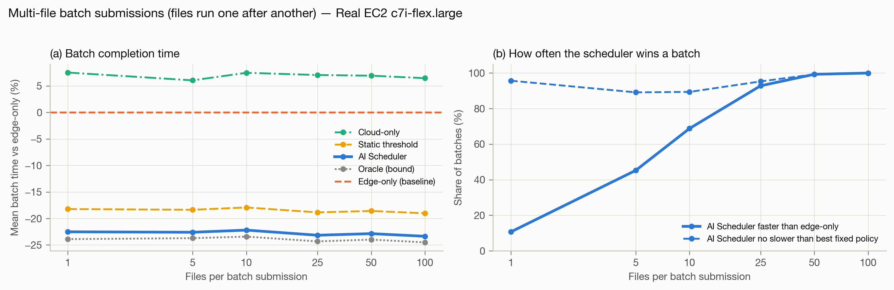
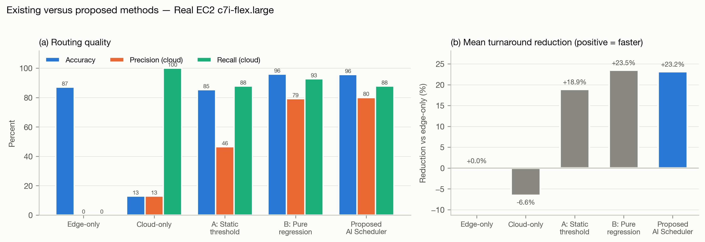

# Additions for the AI Scheduler paper

Ready-to-paste sections, numbered to match `AI-Scheduler_1.pdf`. Every number comes from
`bench/paper_eval.py` (regenerate with `python3 bench/paper_eval.py`); tables are also in
`bench/paper/tables/` as CSV and LaTeX, figures in `bench/paper/figures/` as PNG and PDF.

> **Before submitting, replace these claims in the current PDF.** They describe the first version of the
> system and are contradicted by this repository's measurements:
> * "Random Forest classifier ... routing accuracy 99.4 % ± 0.4 %, F1 0.99" (Abstract, Tables III, IV, VI,
>   Sections 4.4, 5.1, 6). That classifier was trained on a synthetic label it could re-derive from its own
>   features; the system now routes with the regression rule alone, and its measured routing accuracy is
>   95.6 % on real EC2 (Table VI below).
> * "503 scripts", "t3.micro", "ap-south-2", "nine features", "R² 0.972 / 0.955": the current dataset is 633
>   scripts measured on a c7i-flex.large in ap-south-1, with 13 features and R² 0.927 / 0.958.
> * The "existing vs proposed" figures in the earlier draft (68.2 % / 76.4 % / 99.4 %, +44.7 % turnaround)
>   cannot be reproduced from this code or data. Use Table VI below instead.

---

## 3.5 Execution and Report: single-file and multi-file submission (add after the current Section 3.5 text)

The dashboard's Live Dispatch view accepts work in two forms.

**Single-file submission.** The user pastes or edits one Python program (four presets are provided:
matrix multiplication, string processing, recursive Fibonacci, and nested loops) and presses *Run*. The
program passes through the full pipeline once: Code Analysis extracts the static features, Network Check
supplies the current RTT, Prediction and Routing chooses a node, and Execution and Report runs it there.
The view reports the routing decision with its confidence, the predicted edge and cloud latencies, the
predicted offload gain, the worker's compute time and the end-to-end time, and the program's output.

**Multi-file batch submission.** The user uploads any number of `.py` files at once. Each file is decoded and
treated as an independent job: it is analysed, routed and executed on its own, so files in one batch can run
on different nodes, and one failing file does not stop the others. Files run one after another in upload
order, and each gets its own result panel. Every job, single or batched, goes through the same dispatcher, so
cloud-error fallback to the edge, the circuit breaker, live RTT tracking and the decision log apply equally.

```
Algorithm 5: Multi-file batch submission
Input: uploaded files F_1..F_n, dispatcher Disp
Output: per-file report R_i
 1  for i = 1..n:
 2      S_i <- decode_utf8(F_i)
 3      X_i <- CodeAnalysis(S_i)                      // syntax error -> report and continue
 4      D_i <- Route(X_i, tau_RTT)                     // Algorithm 3
 5      R_i <- ExecuteAndReport(S_i, D_i)              // Algorithm 4, falls back to edge on cloud error
 6  return R_1..R_n                                    // batch time = sum of per-file times
```

---

## 4.5 Execution results: single-file and batch submissions (replace Table V and its text)

**Single-file submissions.** Table V shows representative programs submitted one at a time. The predictions
are out-of-fold (the program's family was not in the training data), and the measured times come from the
EC2 collection run, in which every program ran on both nodes, so each routing decision can be checked
against the true faster node.

TABLE V. SINGLE-FILE SUBMISSIONS ON REAL EC2 (c7i-flex.large, measured RTT 155 ms)

| Workload | Pred. edge (s) | Pred. cloud incl. RTT (s) | Routed to | Measured edge (s) | Measured cloud end-to-end (s) | Faster node | Correct |
| --- | ---: | ---: | :---: | ---: | ---: | :---: | :---: |
| `numpy_matmul_2000.py` | 1.268 | 0.474 | Cloud | 1.448 | 0.651 | Cloud | yes |
| `blassvd_1000.py` | 0.598 | 0.363 | Cloud | 1.188 | 0.695 | Cloud | yes |
| `nested_2000x3000.py` | 1.705 | 0.634 | Cloud | 1.234 | 0.754 | Cloud | yes |
| `fib_35.py` | 12.282 | 4.151 | Cloud | 2.119 | 1.047 | Cloud | yes |
| `sort_1000000.py` | 0.541 | 0.379 | Cloud | 1.520 | 0.758 | Cloud | yes |
| `dict_1000000.py` | 0.587 | 0.486 | Cloud | 3.563 | 1.280 | Cloud | yes |
| `fib_33.py` | 8.830 | 3.075 | Cloud | 0.804 | 0.909 | Edge | no |
| `string_250000.py` | 0.103 | 0.253 | Edge | 0.171 | 0.211 | Edge | yes |
| `fib_24.py` | 0.130 | 0.194 | Edge | 0.028 | 0.205 | Edge | yes |
| `string_50000.py` | 0.045 | 0.205 | Edge | 0.032 | 0.174 | Edge | yes |
| `script_001.py` | 0.019 | 0.169 | Edge | 0.015 | 0.163 | Edge | yes |

**Inference.** Heavy numerical and long-running Python programs (matrix multiplication, SVD, 6-million-iteration
loops, sorting and dictionary building at 10⁶ elements) were offloaded, and the cloud's measured end-to-end
time was lower in every case but one. Short programs (under ~0.2 s locally) stayed at the edge: with a 155 ms round
trip, offloading could not have helped them. That one error, `fib_33.py`, is a near tie (edge 0.80 s vs cloud
0.91 s end to end) where the static estimate overstated the work: the cost of the wrong choice was 0.1 s.
Predicted latencies for recursive programs can be several times too high (fib_35: predicted 12.3 s on the edge,
measured 2.1 s), but the *ratio* between the two nodes, which is what routing uses, was still right.

**Multi-file batch submissions.** To measure batches, random sets of 1 to 100 programs were drawn from the 633
measured programs (2000 batches per size) and each policy's batch completion time was computed from the
measured per-program times (Table VII, Fig. 5).

TABLE VII. MULTI-FILE BATCH SUBMISSIONS ON REAL EC2 (mean batch completion time)

| Files per batch | Edge-only (s) | Cloud-only (s) | Static threshold (s) | AI Scheduler (s) | Oracle (s) | Scheduler vs edge-only | Batches where scheduler beats edge-only | ...beats both fixed policies |
| ---: | ---: | ---: | ---: | ---: | ---: | ---: | ---: | ---: |
| 1 | 0.57 | 0.61 | 0.46 | **0.44** | 0.43 | -22.5% | 11% | 0% |
| 5 | 2.94 | 3.12 | 2.40 | **2.28** | 2.24 | -22.6% | 45% | 45% |
| 10 | 5.79 | 6.22 | 4.75 | **4.50** | 4.43 | -22.2% | 69% | 69% |
| 25 | 14.17 | 15.17 | 11.50 | **10.89** | 10.73 | -23.2% | 93% | 93% |
| 50 | 28.89 | 30.90 | 23.52 | **22.29** | 21.96 | -22.9% | 99% | 99% |
| 100 | 57.78 | 61.51 | 46.78 | **44.28** | 43.61 | -23.4% | 100% | 100% |



*Fig. 5. Multi-file batch submissions on real EC2: (a) mean batch time relative to edge-only; (b) share of
batches in which the AI Scheduler is faster than edge-only, and no slower than the better of the two fixed
policies.*

**Inference.** Routing each file independently cuts the mean batch completion time by about
22 % at every batch size, close to the oracle and ahead of the static threshold. Sending the
whole batch to the cloud is consistently *slower* than keeping it local (+6 to +8 %), because most programs are
short and pay the round trip for nothing. Batching makes the benefit dependable: a single file is
usually light, so the scheduler matches edge-only (it is faster on 11 % of single files, and never
slower than the better fixed policy on 96 %), but with 25 files it is faster than edge-only in
93 % of batches and with 50 or more in 99 %. Files currently run sequentially; running
the edge and cloud shares of a batch in parallel would shorten batches further and is left to future work.

---

## 5.1 Accuracy and performance: existing versus proposed (replace Section 5.1 and Table VI)

The proposed system was compared on the same 633 programs, measured on both nodes, with two fixed policies
and two existing methods: **Method A (static threshold)**, a rule that offloads whenever the static cost
estimate exceeds a threshold tuned on the training data, and **Method B (pure regression)**, two independently
trained gradient-boosted latency regressors compared directly (the earlier design). Every method was scored
with whole program families held out of training. Misrouting rate is the share of programs sent to the slower
node; turnaround reduction is relative to always running at the edge (positive is faster).

TABLE VI. ACCURACY AND PERFORMANCE: EXISTING VERSUS PROPOSED (real EC2, 633 programs)

| Metric | Edge-only | Cloud-only | A: Static threshold | B: Pure regression (two GBT regressors) | Proposed AI Scheduler |
| --- | ---: | ---: | ---: | ---: | ---: |
| Routing accuracy | 87.0 % | 13.0 % | 85.3 % | 95.9 % | **95.6 %** |
| Precision (cloud offload) | 0.0 % | 13.0 % | 46.5 % | 79.2 % | **80.0 %** |
| Recall (cloud offload) | 0.0 % | 100.0 % | 87.8 % | 92.7 % | **87.8 %** |
| F1-score | 0.000 | 0.229 | 0.608 | 0.854 | **0.837** |
| MCC | 0.000 | 0.000 | 0.568 | 0.834 | **0.813** |
| Misrouting rate | 13.0 % | 87.0 % | 14.7 % | 4.1 % | **4.4 %** |
| Decision overhead | 0.00 ms | 0.00 ms | 0.18 ms | 12.95 ms | **5.19 ms** |
| Mean turnaround per job | 0.578 s | 0.616 s | 0.469 s | 0.442 s | **0.444 s** |
| Mean turnaround reduction vs edge-only | +0.0 % | -6.6 % | +18.9 % | +23.5 % | **+23.2 %** |



*Fig. 4. Existing versus proposed methods on real EC2: (a) routing accuracy, precision and recall for the
"cloud is faster" class; (b) reduction in mean turnaround time relative to edge-only.*

The same comparison on every dataset (routing accuracy / mean turnaround reduction):

| Dataset | Scripts | A: Static threshold | B: Pure regression | Proposed AI Scheduler |
| --- | ---: | ---: | ---: | ---: |
| Similar hardware | 495 | 99.8 % / +0.0 % | 99.4 % / -3.1 % | **99.8 % / +0.0 %** |
| Asymmetric (591) | 591 | 87.1 % / +10.8 % | 93.2 % / +6.9 % | **95.8 % / +12.4 %** |
| Asymmetric + heavy (633) | 633 | 87.2 % / +22.3 % | 96.2 % / +23.9 % | **96.5 % / +24.1 %** |
| Real EC2 c7i-flex.large | 633 | 85.3 % / +18.9 % | 95.9 % / +23.5 % | **95.6 % / +23.2 %** |

**Inference.** Both learned methods clearly beat the static threshold on real EC2: routing accuracy rises from
85.3 % to about 96 %, cloud-offload precision from 46 % to 80 % (the threshold sends many
short programs to the cloud for nothing), and the mean turnaround reduction from 18.9 % to
23.2 %. Always offloading is 6.6 % slower than always running locally. On the EC2 data the proposed
scheduler and pure regression are within half a point of each other (pure regression is marginally ahead:
23.5 % vs 23.2 %). The proposed design matters when a workload family has more work than anything
in training: on the 591-program set without the heavy BLAS families, pure regression reaches only
6.9 % (it predicted 0.07 s for 4 s matrix multiplications and never offloaded them) while the proposed
scheduler reaches 12.4 % and also beats the threshold there. The proposed method is therefore the most
consistent across datasets, and it decides in 5.2 ms versus 12.9 ms for pure regression (fewer trees),
negligible next to the 155 ms network round trip.

---

## Also update

* **Section 4.3 (Network Check):** the EC2 collection measured a median RTT of 154.9 ms to ap-south-1
  (interquartile range 139–163 ms, p90 175 ms, 21 probes).
* **Section 5.2 (Limitations):** add that the edge is a CPU-quota-limited container (Docker `--cpus=0.5`) on
  an Apple-silicon laptop rather than a separate low-power device; that the EC2 data is one collection run;
  and that batch files run sequentially.
* **Abstract and Conclusion:** report routing accuracy 95.6 %, a 23.2 % turnaround reduction versus edge-only
  and 27.9 % versus cloud-only on real EC2, instead of 99.4 %.
